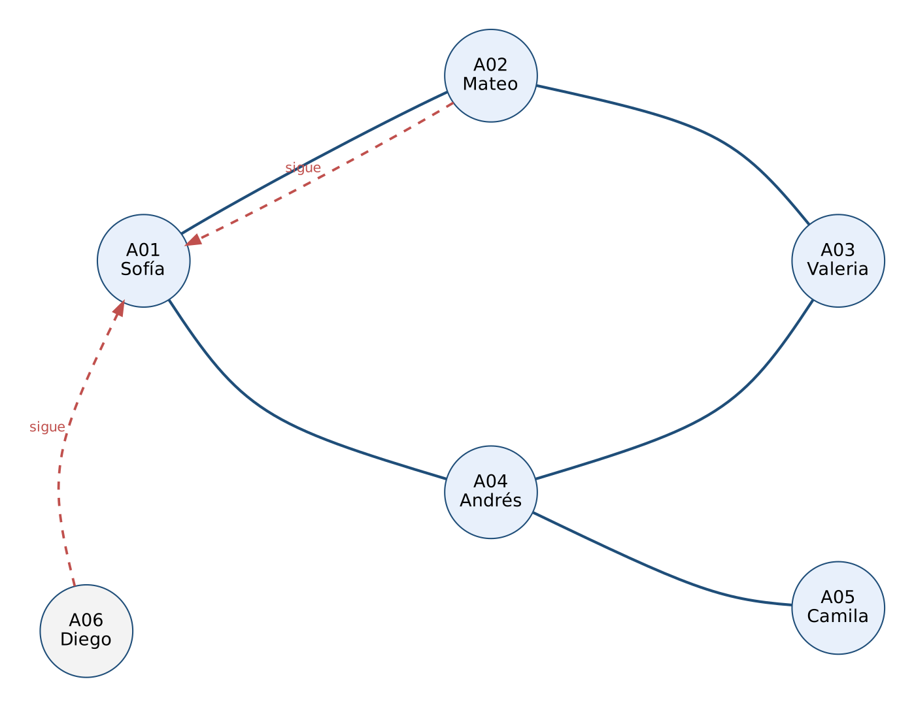

# APE 4 - Fase 2: Conexion Ambato (Grafos)

Estructura de Datos - Ing. José Caiza, Mg.
Universidad Técnica de Ambato, Software, Tercero "B"
Jonathan Tenorio

Red social hecha con lista de adyacencia (multilista) usando nodos propios, sin HashMap,
ArrayList ni LinkedList. La amistad se guarda en los dos sentidos y seguir solo en un
sentido. No se permiten lazos ni relaciones repetidas, y el usuario se busca en minúsculas
(A01 y a01 son lo mismo).

## Archivos

- `src/RedSocial.java`: clases Persona, Vertice, Arista y todas las operaciones
- `src/Main.java`: ejecuta los pasos de la guía (Tabla 3) y tiene un menú
- `test/PruebasRedSocial.java`: 40 pruebas
- `run.bat` / `run.sh`: para compilar y ejecutar
- `docs/`: informe en PDF y Word, y las capturas

## Como ejecutar

En Windows:

```
run.bat            (pasos de la guía)
run.bat menu       (menú)
run.bat pruebas    (pruebas)
```

O a mano:

```
javac -encoding UTF-8 -d out src/*.java test/*.java
java -cp out Main
java -cp out PruebasRedSocial
```

Si las tildes salen mal en la consola de Windows, ejecutar antes `chcp 65001`.

## Resultados

Los 8 pasos de la guía dan lo esperado y pasan las 40 pruebas.

| Etapa | Personas | Amistades | Seguimientos | Aristas |
|---|---|---|---|---|
| Paso 1 | 6 | 5 | 0 | 10 |
| Pasos 2 y 3 | 6 | 5 | 2 | 12 |
| Paso 5 | 6 | 4 | 2 | 10 |
| Paso 6 | 5 | 2 | 0 | 4 |


